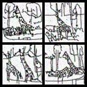
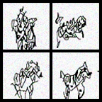
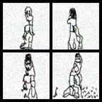
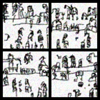
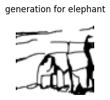
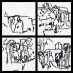
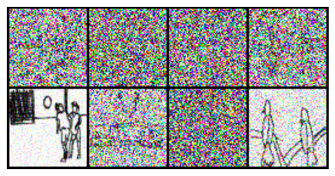
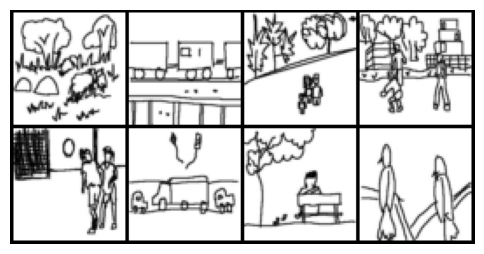

# Diffusion-from-Scratch

A from-scratch PyTorch implementation of a **Denoising Diffusion Probabilistic Model (DDPM)**, built up from the original paper and then extended into a **text-conditional, classifier-free-guided text-to-image model** à la Stable Diffusion — operating directly in pixel space at 64×64.

📄 Paper: [Denoising Diffusion Probabilistic Models (Ho et al., 2020)](https://arxiv.org/pdf/2006.11239)
🎨 Dataset: [`zoheb/sketch-scene`](https://huggingface.co/datasets/zoheb/sketch-scene) — scene sketches with text captions.

---

##  Results

The model is given a **text prompt** and starts from pure Gaussian noise, then iteratively denoises over 1000 steps to produce a sketch. Each image below is a 2×2 grid of independent samples for the same prompt.

| `"A giraffe is standing in a zoo"` | `"a zebra"` |
|:---:|:---:|
|  |  |

| `"A man is standing"` | `"People gathered over a park"` |
|:---:|:---:|
|  |  |

**Single-prompt generation — `"an elephant"`:**



**Unconditional DDPM** (no text, trained first as a baseline):



Full reverse-diffusion videos (noise → sketch) for each prompt are in [`outputs_from_conditional_model/`](outputs_from_conditional_model).

---

## How it works

Diffusion models learn to generate images by **reversing a gradual noising process**.

### 1. Forward process — add noise  (`src/forward_process.py`)
Starting from a clean image `x₀`, Gaussian noise is added over `T = 1000` steps using a linear β schedule (`0.0001 → 0.02`). Thanks to the closed form, we can jump to any noise level `t` in a single step:

```
x_t = √(ᾱ_t) · x₀  +  √(1 − ᾱ_t) · ε ,   ε ~ N(0, I)
```



*Top: heavily noised images at large `t`. Bottom: lightly noised images at small `t`.*

### 2. Reverse process — the denoising network  (`src/reverse_process_architecture.py`)
A **U-Net** is trained to predict the noise `ε` that was added. It is conditioned on three signals:

- **Timestep** — sinusoidal positional embeddings (`TimeEmbedding`) tell the network how noisy the input is.
- **Text** — a **frozen CLIP text encoder** (`openai/clip-vit-base-patch32`) turns the prompt into token embeddings.
- **Cross-attention** — `CrossAttentionBlock` injects the text embeddings into the image features (query = image, key/value = text), the same mechanism used by Stable Diffusion.

The U-Net has a 3-level down / mid / up structure with skip connections; every `ResBlock` receives the time + text conditioning.

### 3. Sampling — generate an image  (`src/inference.py`)
Starting from pure noise `x_T ~ N(0, I)`, the model denoises step-by-step back to `x₀`, using **classifier-free guidance** to strengthen adherence to the prompt:

```
ε = ε_uncond + s · (ε_cond − ε_uncond)        # guidance scale s = 7.5
```

`sample_images_progress` snapshots intermediate steps, and `save_video` stitches them into an MP4 showing noise resolving into a sketch.

### Training trick — classifier-free guidance  (`main.py`)
During training, the caption is randomly dropped to `""` **10% of the time**, so the single network learns both *conditional* and *unconditional* denoising. At inference, mixing the two (above) lets us dial prompt strength up or down.

---

## Project structure

```
Diffusion-from-scratch/
├── main.py                              # Training + inference entry point
├── src/
│   ├── forward_process.py               # Noising schedule + forward diffusion
│   ├── reverse_process_architecture.py  # U-Net, CLIP text encoder, cross-attention
│   ├── load_sketch_data.py              # sketch-scene dataset + dataloaders
│   └── inference.py                     # DDPM sampler + classifier-free guidance + video
├── notebooks/ddpm.ipynb                 # Original unconditional DDPM exploration
├── conditional_ddpm.ipynb               # Text-conditional development notebook
├── outputs_from_conditional_model/      # Generated videos & images per prompt
└── assets/                              # README figures
```

Example training data (`zoheb/sketch-scene`, resized to 64×64):



---

## Installation

```bash
pip install -r requirements.txt
```

Dependencies: `torch`, `torchvision`, `transformers`, `datasets`, `imageio`, `imageio-ffmpeg`.

---

## Usage

Training runs on CUDA. Edit the hyperparameters near the top of `main.py` (`BATCH_SIZE`, `num_epochs`, `T`, learning rate, `MODEL_PATH`), then:

```bash
python main.py
```

- If a checkpoint exists at `MODEL_PATH`, it loads and runs **inference** only.
- Otherwise it **trains** (resuming from the latest `conditional_ddpm_epoch_*.pth` if present), saving checkpoints every 100 epochs, and generates a sample video at the end.

To generate from your own prompt, change `text_prompt` in `main.py`:

```python
text_prompt = "A giraffe is standing in a zoo"
samples = sample_images_progress(model, T, num_images=4, img_size=64,
                                 save_every=5, text_prompt=text_prompt,
                                 guidance_scale=7.5)
save_video(samples, T, filename=text_prompt + ".mp4", fps=20)
```

> **Note:** the device is currently hardcoded to `"cuda"`. Running on CPU/Apple-Silicon (MPS) requires swapping those out.

---

## Notes & limitations

- **Pixel-space, 64×64** — unlike Stable Diffusion there is no latent VAE, so resolution is limited and fine detail is coarse.
- **Sketch domain** — trained only on black-and-white scene sketches, so outputs are line-art, not photos.
- This is an educational implementation meant to make every piece of the diffusion pipeline explicit and hackable.

## License

See [LICENSE](LICENSE).
